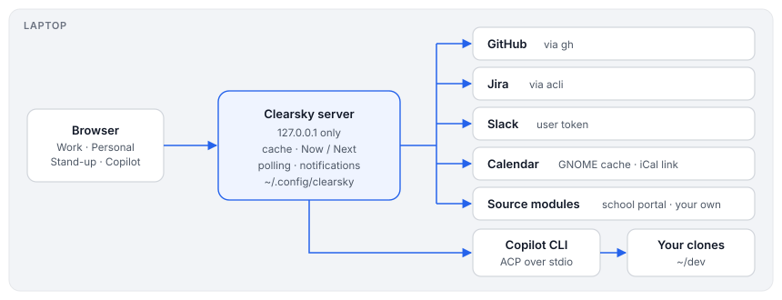

# Design: how Clearsky works

Written 2026-10-29. This covers the shape of the system. The README covers setup and use.

## Goal

Clearsky is one local page that shows what needs your attention at work, and next to it a few personal things:

- **Work:** GitHub reviews and PRs, tickets and mentions from Jira or GitHub Issues (or none, see [Where your tickets live](trackers.md)), and plugins such as Slack.
- **Personal:** school messages.
- **Both:** the calendar, shown as today's schedule.

The chat next to it runs in GitHub Copilot CLI or Claude Code ([The agent behind your chats](agents.md)). Below, "Copilot" stands for either. It runs on the laptop, uses the logins already there, has no dependencies beyond Node 22, and sends nothing anywhere except to the services it reads.

## Parts

| Part | Where | What it does |
|---|---|---|
| Server | `bin/clearsky.mjs` | HTTP on 127.0.0.1, caches sources, plans Now / Next, polls for notifications, talks to Copilot |
| Modules | `lib/modules/*.mjs` | GitHub, Jira (through acli) and Calendar: each fetches its service, turns it into work items, and declares what it holds and reaches |
| Item model | `lib/items.mjs` | the one kind of row every list draws, with the next step on each item |
| Page | `web/index.html`, `web/css/app.css`, `web/js/*.js` | A menu and one work area: the Work list, an item in full, Copilot chats, Calendar, Stand-up and a page per extra source; the server puts the CSS and scripts inline, so there's no build step |
| Settings | `web/settings.html`, `lib/settings.mjs` | writes `~/.config/clearsky/.env` (mode 600); never sends saved secrets back |
| Sources | built in, plus `lib/sources/*.mjs` and `~/.config/clearsky/sources/*.mjs` | each one fetches one service; see the contract in `lib/sources.mjs` |
| State | `lib/state.mjs` → `~/.config/clearsky/state.json` | done, muted and dismissed items, what was already notified, session links |
| Copilot | `lib/acp.mjs`, `lib/copilot.mjs` | the Copilot CLI over ACP (JSON-RPC on stdio), in every access mode |
| Calendar | `lib/eds.mjs`, `lib/ics.mjs` | GNOME's Evolution cache (SQLite) or an iCal link, parsed locally |
| Notifications | `lib/notify.mjs` | what's new since last time; desktop banners over D-Bus (`gdbus`), or the browser's |

## Sources

GitHub (through `gh`), Jira (through `acli`, never direct REST tokens) and the calendar are built in. Everything else, Slack and Grafana included, is a plugin (`plugins/`, [plugins.md](plugins.md)) or a source module with `name`, `label`, `area` (`work` or `personal`), `settings`, `fetch(ctx)` and optional hooks:

- `items`: rows for its panel;
- `attention`: what should notify you when it's new;
- `events`: calendar entries; `fyi: true` events show but don't take your time;
- `standup`: lines for Yesterday and Today;
- `detail` and `attachment`: read an item in full inside Clearsky;
- `plan` and `markdown`: tasks for Now / Next and lines for `--md` (work sources);
- `login` or `logins`: one login, or several, started from Settings;
- `doors`: commands Copilot chats run through Clearsky (`grafana …`), for plugins that run inside.

The source's `area` decides its tab. Only the calendar mixes work and personal.

Files in `~/.config/clearsky/sources` load only if you own them and nobody else can write to them. A source that throws only breaks its own panel.

## Now / Next and the day

`planNow()` turns the calendar plus the work items into:

- the current or next meeting;
- the free slot until then (back-to-back meetings count as one block, and the daily stand-up counts even without a calendar entry);
- up to three tasks that fit the slot, most urgent first.

Events on a shared calendar (like Family) only take your time when you organised them, were invited, or your name is in the title. Calendars you hide neither show nor take time. Today's schedule draws the same data as a timeline.

## Copilot

The panel drives the Copilot CLI on the laptop in ACP mode, so sessions are Copilot's own:

- History lists every session, whether started here, in a terminal or in an editor.
- Reopening one replays it.
- A session counts as open while a live process holds its `inuse.<pid>.hold` file.

A first message carries a short dashboard summary plus any attached PRs or tickets, after a marker, so titles and links use only what you typed.

Sessions link to PRs and tickets in three ways:

- by the item you attached;
- by a checkout of the PR's branch;
- by a key or PR number in the title.

A chat about a PR runs in your local clone of that repo.

Every access mode runs over ACP, so anything Copilot wants your OK for (each step in Ask, the sandbox's doors out in Sandboxed) shows as Allow/Deny. Copilot gets none of Clearsky's tokens, and skills never merge, approve, force-push or comment without asking.

## Security

- **Network:** the server listens on 127.0.0.1 only and refuses other `Host` headers (DNS rebinding).
- **Requests:** writes need a per-install CSRF token from the page.
- **Files:** config and state files are mode 600.
- **Secrets:** they never go back to the browser.
- **School attachments:** served with `nosniff` and a sandbox CSP.

[Remote access](remote-access.md) describes what would change to reach it from a phone.

## Deliberate limits

- No dependencies and no build step: everything is plain Node 22 and one HTML file per page.
- Read-only towards the services: Clearsky never replies, merges or marks anything as read.
- Work data only on the work side. The work tokens stay on the laptop.
