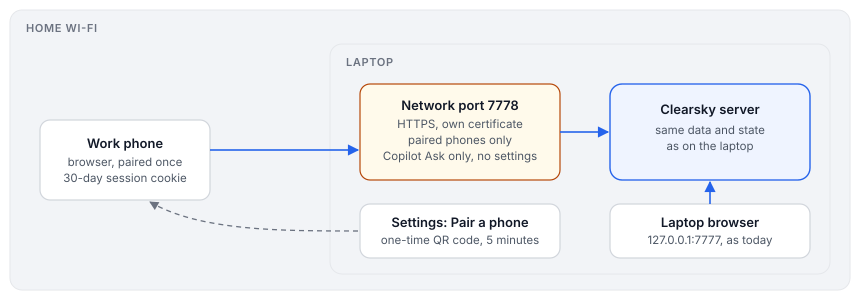

# Design: Clearsky on the work phone, over the home network

Status: **on hold** (design only, nothing built). Written 2026-10-29. A smaller step than [Remote access](remote-access.md): the phone reaches the laptop directly on the same Wi-Fi, with nothing going through Cloudflare or any other outside service.

## Goal

Open Clearsky on the work phone while it is on the same network as the laptop: check the inbox, the calendar and the school messages, answer a Copilot question, mark things done. Everything keeps running on the laptop, as today.

Things that stay as they are:

- The laptop's own browser keeps using `http://127.0.0.1:7777` with no login.
- Nothing is reachable from the internet. When the laptop sleeps or leaves the network, the phone can't reach it, and that is expected.

## Recommendation in short

1. **Off by default.** Settings gets a **Phone access** switch. Only when it's on does Clearsky also listen on the network, on a second port with HTTPS.
2. **HTTPS with Clearsky's own certificate.** Clearsky makes a small certificate authority once, signs a certificate for the laptop's name and address, and shows the authority as a QR code to install on the phone. Without HTTPS the phone can't keep a secure login, use the microphone button or show notifications.
3. **Pair the phone instead of a password.** Settings on the laptop shows a pairing QR code that works once, for 5 minutes. Scanning it on the phone logs that phone in for 30 days. Settings lists paired phones and can remove one. Nobody on the network can guess their way in, because there's no password to guess.
4. **Less power from the phone.**
   - Copilot runs in **Ask** mode only, so every step needs your OK on the phone. Full and Sandboxed are refused.
   - Settings, logins and source configuration can't be changed from the phone.
   - Reading, Done, Snooze, Mark read, and answering Allow/Deny all work.
5. **Check the work phone's rules first.** A managed work phone may not allow installing a certificate authority, and your employer may have a view on work data on a personal network. The fallback for the first point is accepting the browser's certificate warning once per phone.

## How it works

### Listening on the network

- With Phone access on, a second server listens on `0.0.0.0:7778` with HTTPS only. The loopback server on 7777 stays plain HTTP and doesn't change.
- The network server accepts only these `Host` headers: the laptop's hostname (`mylaptop.local`), its current LAN addresses, and nothing else. This keeps DNS rebinding blocked, as today.
- It doesn't answer at all to addresses outside private ranges (`10/8`, `172.16/12`, `192.168/16`, `fe80::/10`). That's a second guard if the laptop ends up on a network with public addresses.
- Turning Phone access off closes the port right away and ends every phone session.

### The certificate

- On first use, Clearsky creates a local certificate authority with `openssl`. Its key stays in `~/.config/clearsky/tls/`, mode 600.
- It then signs a server certificate for `mylaptop.local` and the current LAN addresses, valid for a year, and renews it when the address changes.
- Settings shows the authority as a QR code and a download link, to install on the phone once.
- The authority can only be used for Clearsky's own names. It is never added to the laptop's trust store.

### Pairing

1. On the laptop, Settings → Phone access → **Pair a phone** shows a QR code holding `https://mylaptop.local:7778/pair#<code>`. The code is 128 random bits, works once, and expires after 5 minutes.
2. The phone opens the link. Clearsky checks the code and sets a session cookie: `HttpOnly`, `Secure`, `SameSite=Strict`, 30 days.
3. The cookie holds a random token. The server stores only its hash, with the device name the phone reports and when it was last used.
4. Settings lists paired phones with their last use, and **Remove** ends that phone's session at once.

Every network request without a valid cookie gets the login page and nothing else. After 10 failed pairing attempts in a minute, pairing locks for 15 minutes.

The existing CSRF token and same-origin checks apply to the phone exactly as they do on the laptop.

A passkey would be nicer than pairing, but a passkey needs a domain name the phone trusts. Over a self-made certificate that makes it fragile, so pairing comes first and a passkey can follow later.

### What the phone may do

| | Laptop | Phone |
|---|---|---|
| Inbox, item pages, calendar, stand-up, school | yes | yes |
| Done, Snooze, Mark read, Request review | yes | yes |
| Copilot chat | any mode | Ask only; Full and Sandboxed refused on the server |
| Allow/Deny on a Copilot step | yes | yes |
| Settings, logins, sources | yes | no, read-only |
| Attachments (school files) | yes | yes, same sandbox headers |

The server enforces these rules by which listener a request came in on, not by what the page shows.

### Notifications and voice on the phone

- With HTTPS, the phone's browser can show notifications while the Clearsky tab is open. Push while the browser is closed would need a push service, which is out of scope here.
- The microphone button works on the phone. It uses the browser's speech recognition, which sends audio to Google, same as on the laptop.

## What this exposes

- Anyone on the same Wi-Fi can reach the login page, but nothing behind it without a paired phone.
- The phone holds a 30-day session cookie. A lost phone should be removed in Settings. The phone's own lock screen and MDM are the other guard.
- Work data travels over the home network, encrypted with TLS, and doesn't leave it.

## Changes to Clearsky, in order

1. `lib/tls.mjs`: create the authority and the server certificate with `openssl`, and renew on an address change.
2. A second listener (`CLEARSKY_LAN=on`, port `CLEARSKY_LAN_PORT`, default 7778) with the host and private-address checks.
3. Pairing and sessions: `/pair`, a login page, the cookie, `devices` in state.json with hashed tokens, and rate limits.
4. Per-listener rules: Ask-only Copilot, read-only Settings, no logins.
5. Settings → Phone access: the switch, the QR codes, the list of paired phones.
6. Tests: an unpaired request gets nothing, a used or expired code fails, Full Copilot is refused from the network listener, and wrong `Host` headers fail.
