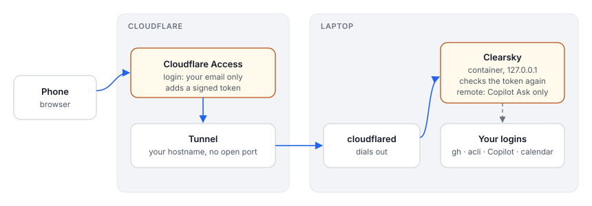

# Design: Clearsky in a container, reachable from the phone

Status: **on hold** (design only, nothing built). Written 2026-10-29.

## Goal

Run Clearsky on the laptop as a non-privileged container instead of a bare `node` process. Later, and only if wanted, open it to the phone through a Cloudflare Tunnel on a dyndns'd domain.

The service stays on the laptop because that is where the logins live: `gh`, `acli`, the Copilot CLI, GNOME Online Accounts and the keyring. A server would need all of them set up again, with work tokens kept on another machine.

## Recommendation in short

1. **Container:** rootless Podman (or Docker with `--user`), with a read-only root filesystem and no capabilities. It runs as Morten's own uid, so files it writes stay his.
2. **Mounts:** only what each feature needs, and read-only wherever possible (table below). The biggest grants are the code folder and `~/.copilot`, because Copilot works in the repos.
3. **Host-only pieces:** a few things don't belong in the container: the BankID login window, the GNOME calendar list (D-Bus) and desktop banners. Each gets a small host-side stand-in instead of the session bus.
4. **Phone access, later:** a Cloudflare Tunnel with Cloudflare Access in front (your email only). Clearsky also checks the Access token itself, and from the phone Copilot is limited to Ask mode.
5. **Employer check first:** the tunnel sends work data through Cloudflare. Ask Kezzler before turning it on.

## What the container needs

| Need | Mount or setting | Mode | Why |
|---|---|---|---|
| Clearsky config and state | `~/.config/clearsky` | rw | `.env`, `state.json`, csrf token, private sources, flyt session file |
| GitHub | `~/.config/gh` | ro | `gh` auth, used for PR data and the PR previews; or pass `GH_TOKEN` |
| Jira | `acli`'s config dir | rw | `acli` refreshes its own login |
| Copilot | `~/.copilot` | rw | sessions (`session-state/`, `inuse.*.hold`), skills, CLI login |
| Code for Copilot | `~/dev` (`CLEARSKY_CODE_DIRS`) | rw | new chats about a PR run in its clone; Copilot edits there |
| git over ssh | `$SSH_AUTH_SOCK`, `~/.ssh/known_hosts` | socket, ro | so Copilot's `git fetch`/`push` works without copying keys |
| Calendar cache | `~/.cache/evolution/calendar` | ro | events come from Evolution's SQLite caches |
| Calendar sources | `~/.config/evolution/sources` | ro | the `.source` files |
| Calendar list from GOA | `~/.cache/clearsky/eds-sources.json` | ro | see below; replaces the D-Bus call |
| Port | `-p 127.0.0.1:7777:7777` | | the server listens on 0.0.0.0 inside, but the host only binds loopback |

The image contains Node 22, `gh`, `acli` and the Copilot CLI, pinned versions. Things it does not need: the D-Bus session bus, the X or Wayland socket, the keyring, `/run/user`, privileged mode, and `--network host`.

Sketch (Podman):

```sh
podman run -d --name clearsky --userns=keep-id --read-only --cap-drop=all --security-opt no-new-privileges \
  --tmpfs /tmp \
  -p 127.0.0.1:7777:7777 -e CLEARSKY_HOST=0.0.0.0 \
  -v ~/.config/clearsky:/home/me/.config/clearsky:Z \
  -v ~/.config/gh:/home/me/.config/gh:ro,Z \
  -v ~/.copilot:/home/me/.copilot:Z \
  -v ~/dev:/home/me/dev:Z \
  -v ~/.cache/evolution/calendar:/home/me/.cache/evolution/calendar:ro \
  -v ~/.config/evolution/sources:/home/me/.config/evolution/sources:ro \
  -v ~/.cache/clearsky:/home/me/.cache/clearsky:ro \
  -v $SSH_AUTH_SOCK:/ssh-agent -e SSH_AUTH_SOCK=/ssh-agent \
  clearsky
```

The container sees paths under `/home/me` while the host has `/home/morten`. Copilot keys sessions by `cwd`, so sessions started in the container wouldn't match the same repo opened in a host terminal. **Mount everything at the same absolute paths as on the host** (`-v ~/dev:$HOME/dev`, with `HOME=$HOME`) so session history stays shared.

## What doesn't fit a container

- **GNOME Online Accounts calendars.** Clearsky lists them with `busctl --user` on the session bus. Mounting the bus socket would also give the container the keyring and every other desktop service. Instead, a systemd user timer on the host writes the same `busctl` JSON to `~/.cache/clearsky/eds-sources.json` every 10 minutes, and `registrySources()` reads that file when `busctl` isn't available.
- **School login (BankID).** This opens a real browser window. Run it on the host with `node bin/clearsky.mjs login flyt` (to add). It writes the session to `~/.config/clearsky/flyt-session.json`, which the container already sees. Inside the container there is no keyring, so `flyt.mjs` falls back to that file. Renewing the login is plain HTTP and works from the container.
- **Desktop banners.** They go over the session bus (`gdbus`). In the container `hasNotifySend()` reports `browser`, so the open page shows notifications instead. If banners are wanted while no tab is open, a host-side `notify-send` relay can read a small queue file, but browser notifications are fine to start with.
- **Settings logins for gh and acli.** These start CLI logins that open a browser. In a container, do the logins on the host, or run `podman exec -it clearsky gh auth login` with a device code. Settings should say so when it detects the container.

## Phone access through a Cloudflare Tunnel (later)

With a Cloudflare Tunnel, the laptop makes an outbound connection to Cloudflare and no inbound port is opened. The tunnel's hostname lives on Morten's own domain in Cloudflare DNS, so the tunnel itself doesn't need dyndns. dyndns is only needed if something else must reach the laptop directly.



Auth, in layers:

1. **Cloudflare Access** on the hostname.
   - Allow only Morten's email: a one-time PIN, or Google or GitHub as the identity provider, with a short session (say 12 hours).
   - Require a device posture check if the plan allows it.
   - This keeps everyone else out before anything reaches the laptop.
2. **Clearsky checks the Access token itself.**
   - Every request through the tunnel carries `Cf-Access-Jwt-Assertion`.
   - Clearsky verifies it against the team's public keys (`https://<team>.cloudflareaccess.com/cdn-cgi/access/certs`), the application's `aud` tag and the allowed email.
   - Requests without a valid token are refused, so a misconfigured tunnel or a missing Access policy fails closed.
   - Loopback requests from the laptop itself skip this check, as today.
3. **Host check.** `CLEARSKY_ALLOWED_HOSTS` adds the tunnel hostname to the current 127.0.0.1/localhost check, so DNS rebinding stays blocked.
4. **CSRF.** The existing per-install token and same-origin rules stay as they are.
5. **Less power from the phone.**
   - Requests that came through the tunnel can use Copilot only in **Ask** mode. Every step needs an OK, and Full is refused on the server.
   - Settings writes and source logins are refused remotely. Change those at the laptop.

What this exposes, even with Access in place: Cloudflare terminates TLS, so it sees the pages (PRs, Jira tickets, calendar, school messages). That is the main reason to check with the employer first.

When the laptop sleeps, the phone gets a Cloudflare error page. That's expected, since the service lives on the laptop.

## Changes to Clearsky, in order

1. `CLEARSKY_HOST` (default `127.0.0.1`), so the server can listen on 0.0.0.0 inside a container.
2. Fallback in `registrySources()` to `~/.cache/clearsky/eds-sources.json`, plus the host-side timer unit in `contrib/`.
3. A `clearsky login flyt` command that runs the BankID login from the terminal.
4. A `Containerfile`, plus a `contrib/clearsky.container` Quadlet file for Podman with the mounts above (same paths as on the host).
5. Settings shows when it runs in a container, and points the gh/acli logins to the host.

Phone access, only after the employer says yes:

6. `CLEARSKY_ALLOWED_HOSTS`.
7. Cloudflare Access JWT check (`CLEARSKY_CF_ACCESS_TEAM`, `CLEARSKY_CF_ACCESS_AUD`, `CLEARSKY_CF_ACCESS_EMAIL`), with a fail-closed test.
8. Restrictions for remote requests: Ask-only Copilot, no Settings writes, no logins.
9. A `cloudflared` config example in `contrib/`.
